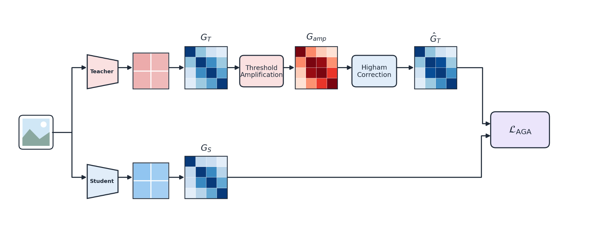
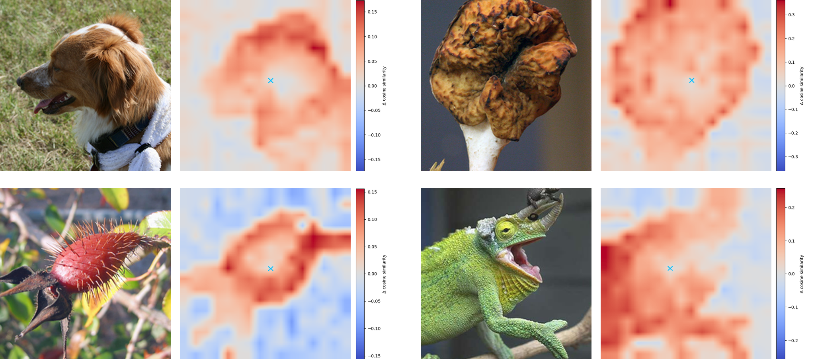

# Amplified Gram Anchoring

### Selectively Strengthening Patch Relationships for Dense Visual Representations

**Amplified Gram Anchoring (AGA)** selectively strengthens patch relationships that are already highly similar in a frozen Gram teacher. It modifies the teacher Gram-matrix target during self-supervised post-training **without adding trainable parameters**. We also evaluate **AGA-H**, which applies a finite-iteration Higham correction to reduce correlation-matrix constraint violations.

Starting from **DINOv2-S/14**, we compare common-initialization refinement for 1,500 iterations using DINO, iBOT, KoLeo and relation losses. We then evaluate frozen representations with lightweight heads on segmentation, depth estimation and image classification benchmarks. Our method is motivated by the Gram Anchoring technique in [DINOv3](https://arxiv.org/abs/2508.10104). Full AGA Research Report is avaliable at **[AGA research report (PDF)](report/AGA_Research_Report.pdf)**

## Method

AGA retains weak teacher similarities while amplifying those above threshold `b`. The student is trained to match the transformed teacher patch-similarity matrix. Higham correction is optional: **AGA (H=0)** or **AGA-H (H=10)** in the main evaluation.



*Method overview. The frozen teacher supplies the target; only the student is optimized. The Higham step is used in AGA-H.*

## Key Results

Across the full frozen-probe protocol, **AGA-H outperformed vanilla Gram Anchoring on all four reported dense benchmarks**, while image classification accuracy stayed close to Gram.

| Dense task | Metric | Gram | AGA-H |
|:--|:--|--:|--:|
| PASCAL VOC 2012 | mIoU ↑ | 77.19 | **78.13** |
| ADE20K | mIoU ↑ | 40.12 | **41.17** |
| Oxford-IIIT Pet | mIoU ↑ | 75.73 | **76.03** |
| NYUv2 | RMSE ↓ | 0.531 | **0.524** |

*VOC 2012, ADE20K, and NYUv2 were selected and reported on evaluation/validation splits under this study's probe protocol; Oxford-IIIT Pet is evaluated on a held-out test split. These are not standardized leaderboard comparisons.*



*Difference maps for selected image/query-patch pairs (AGA-H minus Gram). The cross marks the query patch; each example uses its own color range.*

The qualitative results show stronger within-object or semantically related patch similarities in selected examples. See [Experimental Results](results/README.md) for the full model comparison, ablations, and limitations.

## Repository Structure

```text
.
├── src/                        # Notebook-derived loss, refinement and evaluation code
├── notebooks/
│   ├── refinement/            # Final clean Kaggle training notebook
│   ├── evaluation/            # Final full-split frozen-probe evaluation
│   └── visualization/         # Patch similarity analysis
├── results/
│   ├── README.md              # Concise experimental comparisons
│   └── figures/              # Figures extracted from the final report
├── report/
│   └── AGA_Research_Report.pdf
└── requirements.txt
```

## Reproduction

1. Install dependencies from `requirements.txt` and obtain the [official DINOv2 repository](https://github.com/facebookresearch/dinov2).
2. Use the [refinement_notebook](notebooks/refinement/aga_refinement.ipynb) with ImageNet-1K access and a CUDA GPU. Set `HIGHAM_MAX_ITER=0` for AGA or `10` for AGA-H; keep `(b, alpha)=(0.4, 8)` for the main settings.
3. Provide trained backbone checkpoints to the [final evaluation notebook](notebooks/evaluation/aga_full_split_frozen_backbone_evaluation.ipynb), select the benchmark tasks and run frozen probes.
4. Run the [post-training analysis notebook](notebooks/visualization/aga_post_training_analysis.ipynb) for similarity maps.

The `src/` modules extract implementation blocks from these **cleaned copies of the original experiment notebooks**; the original executed notebooks and final report remain the record of the actual experiments. The Python files are intended as reusable, notebook-aligned components. Data sources, checkpoint paths and Kaggle-specific settings require configuration for a new environment. See [notebook guide](notebooks/README.md).

## Limitations

Only one backbone scale, one evaluation seed and 1,500 refinement iterations were studied. The Higham procedure uses a finite iteration budget which causes considerable training time cost and is **not guaranteed to produce an exactly PSD target**. Going beyond resource limitations to leverage more diverse datasets and long-term training remains the future work.

## Report and References

- **[Full research report (PDF)](report/AGA_Research_Report.pdf)** — *Amplified Gram Anchoring: Selectively Strengthening Patch Relationships for Dense Visual Representations*
- [DINOv3](https://arxiv.org/abs/2508.10104) — Gram Anchoring motivation
- [DINOv2](https://arxiv.org/abs/2304.07193) — pretrained ViT-S/14 backbone
- [Higham (2002)](https://doi.org/10.1093/imanum/22.3.329) — nearest correlation matrix approximation
