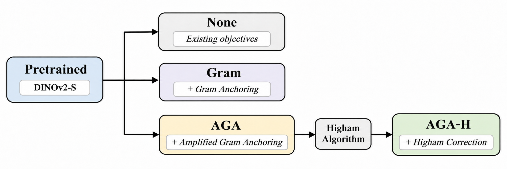
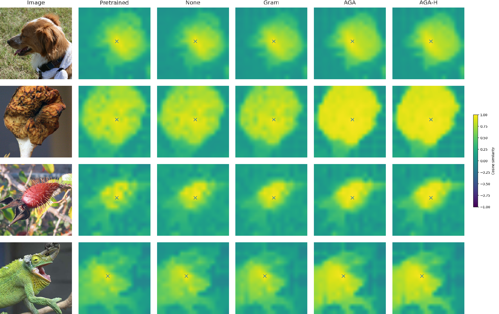
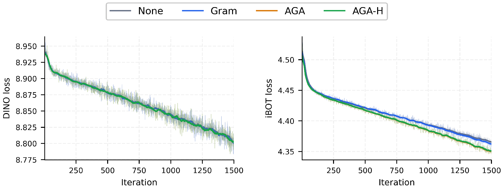
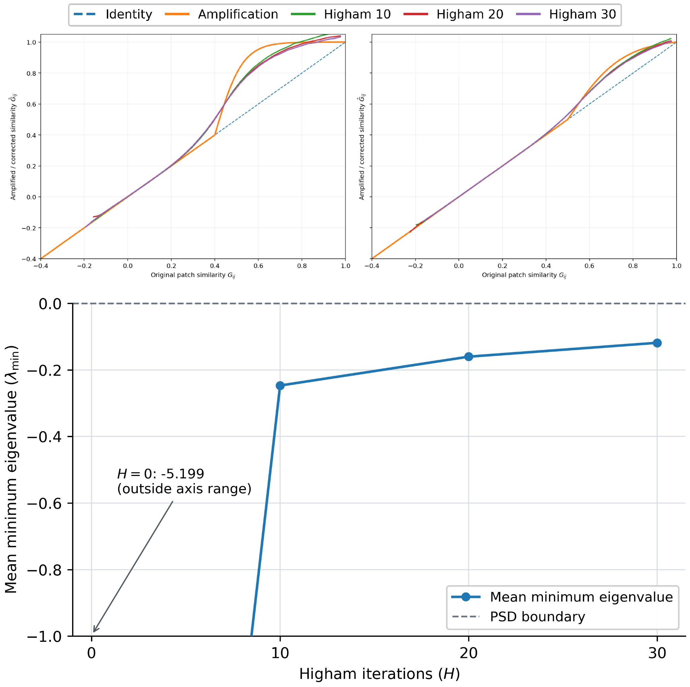
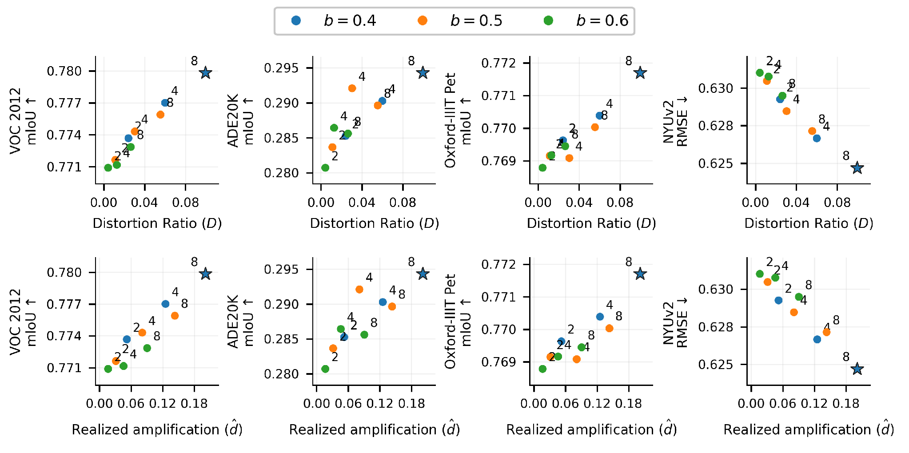

# Experimental Results

This page summarizes the main results and diagnostic observations from the [full research report](../report/AGA_Research_Report.pdf). It focuses on what changed experimentally; full methods, equations, evaluation protocols and references are in the report.

## 1. Experimental Setup

We compare five frozen DINOv2-S/14 backbones under shared lightweight-probe settings:

| Variant | Description |
|:--|:--|
| **Pretrained** | Original off-the-shelf DINOv2-S/14 |
| **None** | DINO + iBOT + KoLeo refinement without a Gram loss |
| **Gram** | Vanilla Gram Anchoring refinement |
| **AGA** | Amplified teacher Gram target (`b=0.4`, `alpha=8`, `H=0`) |
| **AGA-H** | AGA with 10 Higham iterations (`H=10`) |

All refinement runs start from the same pretrained backbone and use 1,500 steps with batch size 80 on a streamed ImageNet-1K training set. The downstream backbone is frozen: segmentation and depth use 1×1 convolution heads and classification uses a linear head on selected features.

*Five backbones in the controlled comparison. AGA-H adds optional target correction without altering the backbone architecture.*

## 2. Dense Prediction Results

**Semantic segmentation · mIoU (%) ↑**

| Model | VOC 2012 | ADE20K | Oxford-IIIT Pet |
|:--|--:|--:|--:|
| Pretrained | 77.25 | 40.63 | 74.61 |
| None | 76.28 | 40.05 | 74.54 |
| Gram | 77.19 | 40.12 | 75.73 |
| AGA | 76.88 | **41.17** | 75.81 |
| **AGA-H** | **78.13** | **41.17** | **76.03** |

**Monocular depth · NYUv2 RMSE ↓**

| Pretrained | None | Gram | AGA | AGA-H |
|--:|--:|--:|--:|--:|
| 0.534 | 0.529 | 0.531 | **0.524** | **0.524** |

AGA-H has the best reported values across all four dense benchmarks under the full frozen-probe protocol. Higham correction is especially beneficial on VOC 2012; for NYUv2, uncorrected AGA matches AGA-H at the displayed precision.

**Evaluation note:** VOC 2012 and ADE20K use official validation splits for checkpoint selection and reporting; NYUv2 selects and reports on the same evaluation split. Oxford-IIIT Pet uses a separately held-out test split after probe refitting.

## 3. Image Classification

**Top-1 accuracy (%) ↑ · held-out test sets**

| Model | CIFAR-100 | Oxford Flowers-102 |
|:--|--:|--:|
| Pretrained | 86.35 | **99.53** |
| None | **87.04** | 99.38 |
| Gram | 86.80 | 99.37 |
| AGA | 86.57 | 99.41 |
| AGA-H | 86.51 | 99.37 |

AGA retains classification accuracy close to Gram in this protocol; it does **not** consistently improve classification. The largest decrease versus Gram is 0.29 percentage points (AGA-H on CIFAR-100).

## 4. Patch Similarity and Refinement Behavior

*Identical images and query patches across Pretrained, None, Gram, AGA and AGA-H. Selected examples show stronger within-object or semantically related patch associations after AGA refinement.*

*DINO loss behaves similarly across refinements. The AGA variants show lower iBOT loss late in training; loss alone does not establish downstream feature quality.*

## 5. Ablation and Higham Correction

The preliminary `(b, alpha)` sweep tested nine settings with `H=20`; **this used a shorter evaluation protocol and is not directly numerically comparable with the full results above**. The `(0.4, 8)` setting led that preliminary grid on the four dense evaluations reported in the research report.

*Higham correction attenuates the nonlinear amplification and reduces negative eigenvalue magnitudes; finite iteration budgets can still leave residual PSD violations.*

*Preliminary relationships between target distortion/amplification and dense scores across nine settings. These are correlations, not evidence of causality.*

## 6. Scope and Limitations

- The full comparison uses a single backbone scale, 1,500 refinement steps and one evaluation seed.
- Higham projection uses a finite iteration count; the transformed matrix is not guaranteed to become exactly PSD.
- VOC 2012, ADE20K and NYUv2 selection/reporting splits are not independent held-out test sets.
- Stronger dense decoders, longer refinement and multi-seed evaluation remain open.

For complete loss definitions, Gram geometry diagnostics, detailed ablation tables, figures, and references, see the [research report](../report/AGA_Research_Report.pdf).
